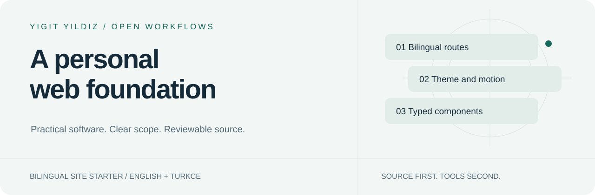

<picture>
  <source media="(prefers-color-scheme: dark)" srcset="assets/hero-dark.svg">
  
</picture>

# iamyigit-site

[English](README.md) · [Türkçe](README.tr.md)

**A bilingual personal-site starter built with Next.js App Router, React and TypeScript.** This repository is the source project, not a claim that the code is currently deployed to iamyigit.com.

## What exists today

| Included | Current scope |
|---|---|
| Turkish and English routes | Home plus about, work, writing and contact route shells. |
| Locale-aware navigation | Switch language while retaining the current route. |
| Theme control | Dark/light state, including safe fallback when browser storage is blocked or invalid. |
| Motion components | Reusable client-side presentation primitives. |
| Metadata files | Layout metadata, robots and sitemap source. Review production URLs before deployment. |
| Verification | Type checking, focused theme-storage tests and production compilation. |

The work, writing and contact sections are **starter content**, not a finished CMS, blog engine or working contact backend. There is no automatic WordPress synchronization.

## Local setup

Use a supported Node.js LTS runtime and the checked-in lock file. No account connection is needed to work on the starter.

~~~sh
npm ci
npm run dev
~~~

Development opens the Next.js local server. For verification and a production build:

~~~sh
npm test
npm run typecheck
npm run build
npm start
~~~

A successful build is not a live deployment. This repository’s CI verifies source; it does not publish to a hosting account. Review any separately configured hosting integration before pushing application changes.

## Where to work

| Area | Source |
|---|---|
| Locale dictionaries | [lib/i18n.ts](lib/i18n.ts) |
| Localized layout and pages | [app/[locale]](app/%5Blocale%5D) |
| Navigation and language switch | [components/nav.tsx](components/nav.tsx) |
| Theme provider | [components/theme-provider.tsx](components/theme-provider.tsx) |
| Storage boundary and tests | [theme storage](lib/theme-storage.ts) · [tests](tests/theme-storage.test.mjs) |
| Global styles | [app/globals.css](app/globals.css) |
| Build commands | [package.json](package.json) |

<strong>Before calling it production-ready</strong>

Replace starter copy, verify both languages, review metadata/canonical URLs, check mobile and keyboard behavior, and decide how writing/contact data will be supplied. Verify the actual deployment environment separately. Do not put private environment values or tokens in the client bundle.

## Project family

[Profile and project directory](https://github.com/yigityildiz0) · [Universal AI Skill Library](https://github.com/yigityildiz0/universal-ai-skill-library)

This project is intentionally separate from the skill library: it is an application starter, not an executable agent skill. [Next.js documentation](https://nextjs.org/docs) is the authority for framework setup and supported runtimes.
